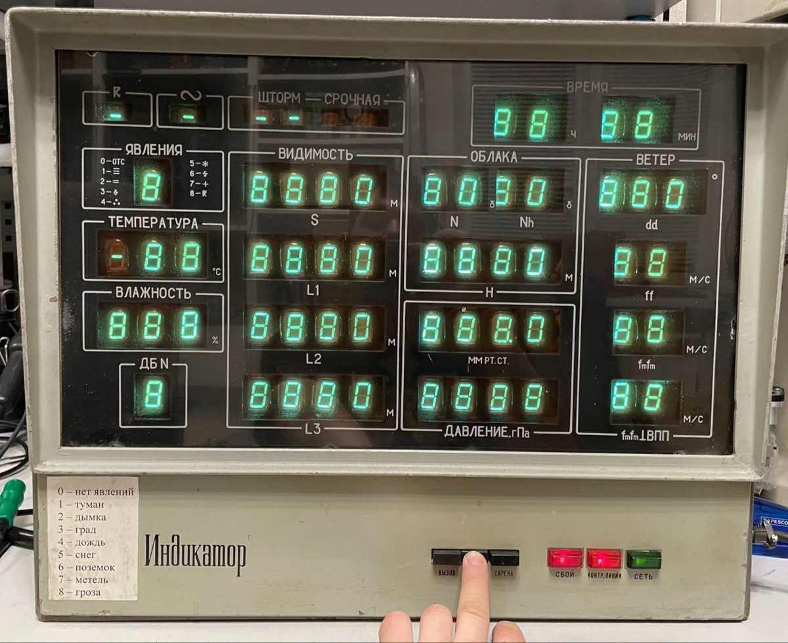
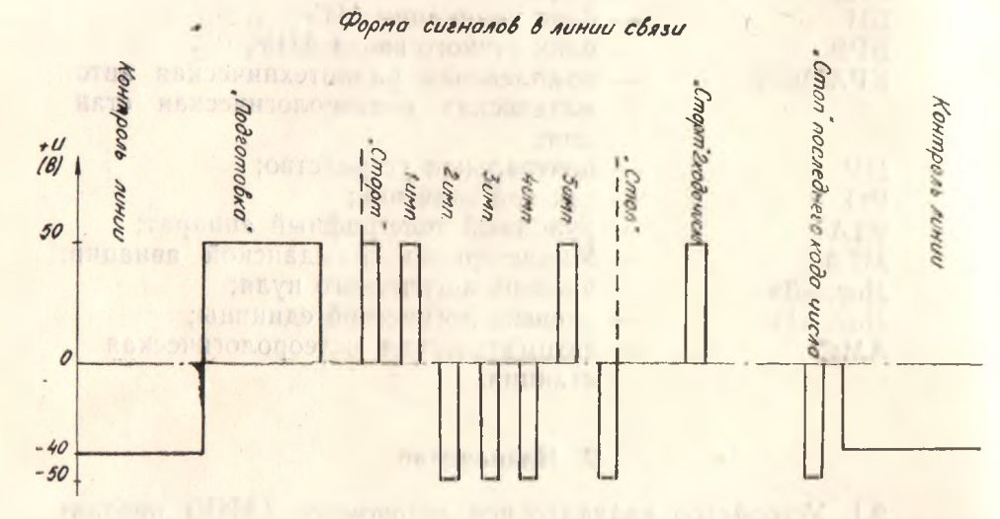
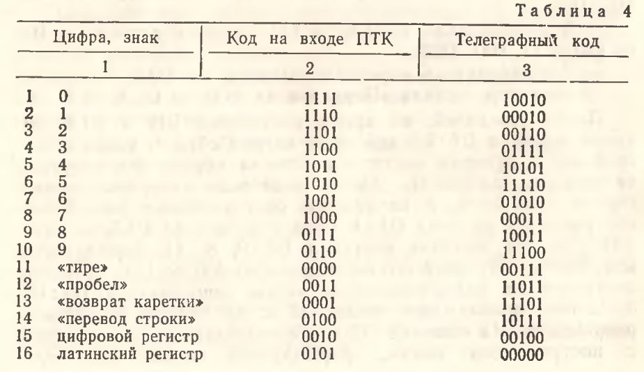
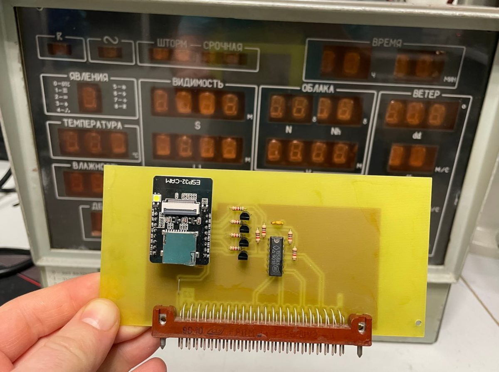
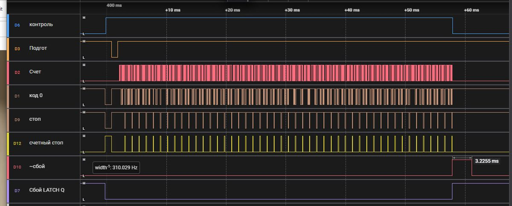
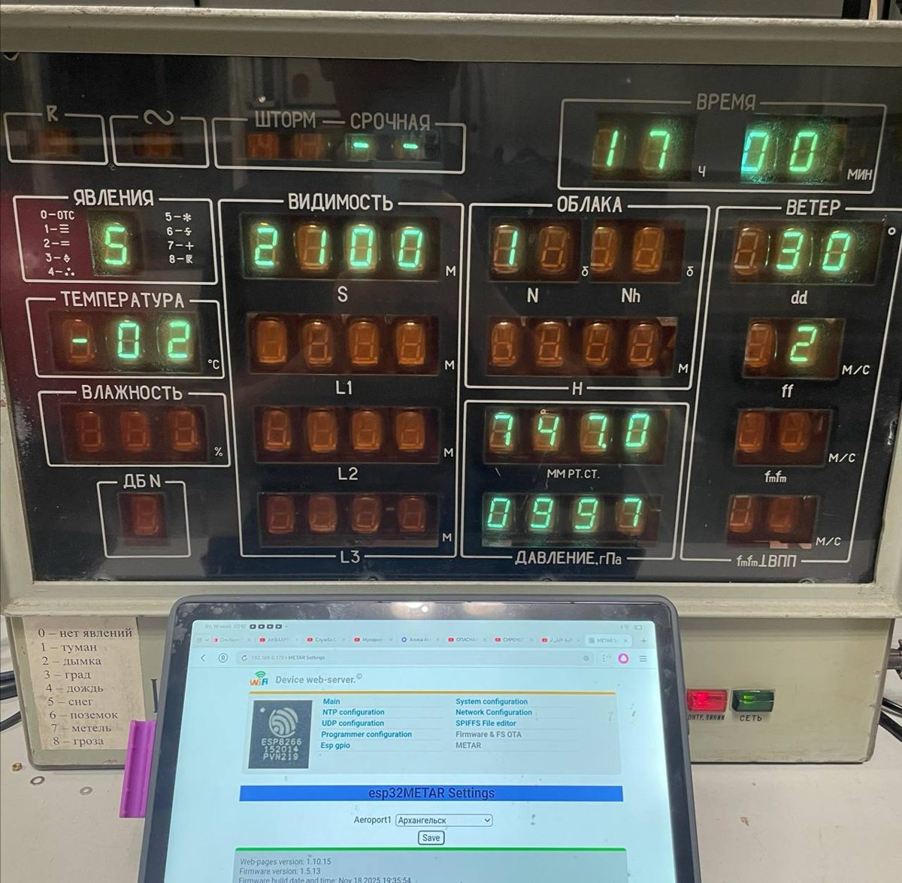

# Метеоиндикатор КРАМС-2 + METAR

Аэродромное табло «Индикатор» из советской метеостанции КРАМС-2, которое снова показывает погоду. Родную интерфейсную плату заменяет ESP32-CAM. Она сама забирает из интернета сводку METAR выбранного аэропорта, раскладывает её по полям табло и передаёт в индикатор его собственным телеграфным протоколом.

Подробный рассказ — статья [«Взламываем Аэродромный Метеоиндикатор»](https://habr.com/ru/companies/timeweb/articles/966800/) на Хабре.



## Что это за прибор

КРАМС-2 (Комплексная Радиотехническая Аэродромная Метеорологическая Станция) была широко распространена в СССР в 80-е. Датчики в помещении, на метеоплощадке и у ВПП сводятся в блок управления и преобразования (БУП). Центральное вычислительное устройство (УЦВС) формирует из них сводки METAR, БИ или ШТОРМ. Сводки уходят на рулонный телеграф, по сети в другие аэродромы и на индикаторные табло.

Это одно из таких табло, «Автономное индикаторное устройство»:

- Габариты 515×420×150 мм, масса 15 кг, стальная рама.
- 56 семисегментных ВЛИ ИВ-22 (цифра 18 мм) за оранжевым оргстеклом.
- Логика на микросхемах 133 серии, четыре платы: управление, преобразователь кода и две платы ОЗУ.
- Отображает только цифры 0–9 и «-». Прочерк гасит разряд, а настоящий минус температуры выводится как «1».

## Протокол линии связи

Посылка состоит из 47 символов. Каждый символ — 5-битный телеграфный код со стартовым и стоповым импульсом. Перед посылкой идёт сигнал «Подготовка», он сбрасывает индикатор. В родной системе амплитуда ±50 В, а в покое в линии −40 В. Если напряжения нет, индикатор считает линию оборванной и пищит.



Коды символов (столбец «Телеграфный код»). Коды пробела, регистров и перевода строки индикатор пропускает, поэтому одну и ту же посылку можно слать и на табло, и на телеграф:



Индикатор защищён от помех тремя способами:
- Отрицательный стартовый импульс считается ложным стартом.
- Неподдерживаемые символы пропускаются, а посылка принимается, только если в ней ровно 47 распознанных символов.
- В ОЗУ хранится бит чётности, и при чтении на табло он проверяется.

### Поля посылки

| Символы | Поле |
|---|---|
| 1–2 | Часы |
| 3–4 | Минуты |
| 5–6 | Направление ветра, десятки градусов |
| 7–8 | Скорость ветра, м/с |
| 9–12 | Давление, гПа |
| 13 | Количество облаков |
| 14–16 | Влажность |
| 17–19 | Температура |
| 20 | Облака нижнего яруса |
| 21–22 | Максимальная скорость ветра |
| 23 | Признак грозы |
| 24 | Явления погоды |
| 25 | Название телеграммы |
| 26 | Номер сообщения |
| 27–29 | Высота облаков |
| 30–32 | Давление, мм рт. ст. |
| 33–41 | Дальность видимости на ВПП 1, 2, 3 |
| 42–44 | Метеорологическая дальность видимости |
| 45–46 | Скорость ветра у ВПП |
| 47 | Гололёд |

У большинства четырёхразрядных полей работают только старшие три разряда, младший всегда показывает 0.

## Подменная плата

Вместо имитатора линии на ±50 В контроллер стоит прямо в корпусе, на месте родной платы входного устройства. Он выдаёт на её разъём четыре сигнала уже в уровнях логики:

| Сигнал | GPIO | Поведение |
|---|---|---|
| Контроль линии | 14 | 1 на всё время передачи, включается раньше «Подготовки» (в оригинале за RC-цепью 0,2 с) |
| Подготовка | 13 | В покое 1, перед посылкой коротко уходит в 0 (в оригинале за RC-цепью 1 с) |
| Счёт | 12 | Строб каждого бита |
| Код 0 | 15 | В покое 1, уходит в 0 при передаче нулевого бита, после фронта «Счёта» |

Уровни 3,3 → 5 В переводят транзисторные инверторы, полярность возвращает К155ЛА3. Модуль ESP32-CAM взят ради разъёма внешней антенны, ведь корпус металлический. Схема лежит в `sch/esp_board.dch` (DipTrace), там же схемы блоков индикатора: `BI_Control.jpg`, `BI_Convert.jpg`, `BI_RAM.jpg`.



Такт бита задаёт `DELAY_US` в `src/krams.cpp`. При отладке он стоял на 1000 мкс, как в проекте radioegor146, подключённом к родному интерфейсу; вся передача тогда занимала несколько секунд. Сейчас там 20 мкс, и посылка уходит примерно за 25 мс.



> **Если табло мигнуло и погасло.** Скорее всего, сработал собирательный сигнал «Сбой»: он появляется через ~3 мс после конца передачи. У этого экземпляра одна из К133ИП2 (контроль чётности ОЗУ) на нижней плате оказалась мёртвой, это видно тепловизором: она не греется. Индикатор заработал после того, как отпаяли её выход проверки чётности. Кнопка «Устранение сбоя» временно показывает принятые данные.

## Прошивка

PlatformIO, плата `esp32cam`, Arduino.

- METAR берётся с `tgftp.nws.noaa.gov` (запасной вариант — `aviationweather.gov`, закомментирован в `src/weather.cpp`).
- Разбор — библиотека [metar_cpp](https://github.com/radiolok/metar_cpp), форк jachappell/METAR. Сначала была metaf, но она после компиляции весит почти 1 МБ и в ESP32 не помещается.
- Wi-Fi, веб-интерфейс, файловая система и обновление по воздуху — из [avr-fota](https://github.com/Arcanum753/avr-fota) (ветка `dev` форка radiolok/avr-fota). `import_fota.py` при сборке сливает `data/` библиотеки и проекта в `merged_data/`.
- Аэропорт выбирается на странице `/metar.html` (ajax `/metar/info`) и сохраняется в `/config_metar.json`. По умолчанию стоит UWGG, Нижний Новгород, Стригино.

```
pio run -e esp32cam -t upload
pio run -e esp32cam -t uploadfs
```



## Что можно доделать

- На табло нет названия аэропорта. Разряды дальности ВПП L3 можно заменить на ИВ-17 и выводить там код ИКАО.
- Заменить блок питания: родной громко звенит ШИМ-ом.

## Ссылки

- Статья: [Взламываем Аэродромный Метеоиндикатор](https://habr.com/ru/companies/timeweb/articles/966800/)
- [avr-fota](https://github.com/Arcanum753/avr-fota)
- [metar_cpp](https://github.com/radiolok/metar_cpp)
